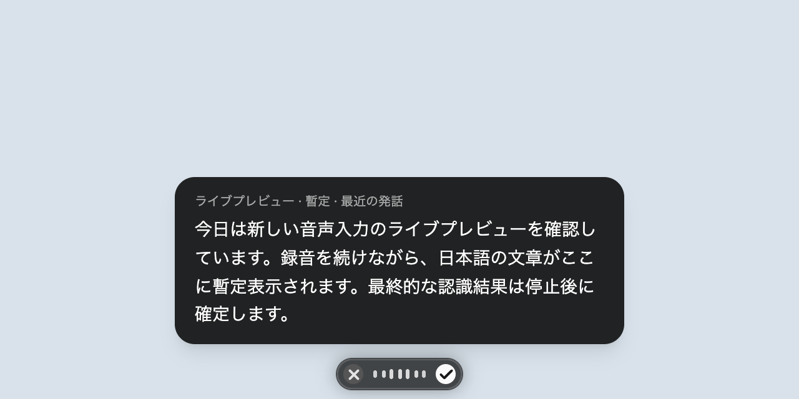

# Local Whisper live preview

While recording with local Whisper, the existing non-focusable widget displays a
**tentative preview of recent speech** above the waveform. It does not activate a
window, copy text, paste text, or change the final transcription/formatting path.
Cloud transcription does not produce previews.



The image above uses synthetic text and audio levels in the actual widget React
component. It is not a microphone accuracy or latency measurement.

## Behavior and cost

- The first preview is eligible after two seconds of audio. Subsequent previews
  require new audio and at least two seconds after the previous decode completes.
- Each speculative decode receives a VAD-filtered snapshot of up to twelve
  seconds of recent audio. The final buffer is never shortened or consumed by a
  preview. The existing three-second silence / thirty-second chunk thresholds
  are unchanged.
- There is at most one speculative job per session. The existing engine mutex
  serializes native inference. Slow models skip preview opportunities instead of
  accumulating a queue. An already-running native decode cannot be interrupted,
  so stopping may still wait for that one decode before final recognition.
- Final batches invalidate older hypotheses. Stop closes preview admission even
  while admitted audio is draining. Cancel, restart, and session/model pinning
  prevent old results from appearing in a later recording. A preview decode
  failure disables speculation for that session; final recognition still runs.
- Preview events carry a session ID, are ephemeral, and are not added to history
  or formatting input. The router forwards them only while that session is
  recording; the widget clears them on every recording-state/session change.
  Displayed text is bounded and follows the bottom of long Japanese input.

## Development and verification

Use Node 24 or newer and initialize the native submodule before installing:

```sh
git submodule update --init --recursive
pnpm install --frozen-lockfile
pnpm --filter @amical/types build
pnpm --filter @amical/whisper-wrapper build
pnpm --filter @amical/desktop type:check
pnpm --filter @amical/desktop exec vitest run \
  tests/pipeline/whisper-provider-session.test.ts \
  tests/renderer/floating-button-recording-triggers.test.ts \
  tests/trpc/recording-router.test.ts \
  tests/i18n/locales.test.ts \
  tests/services/live-transcription-session.test.ts \
  tests/services/transcription-service-provider-pinning.test.ts \
  tests/services/transcription-service-resolve.test.ts \
  tests/main/lifecycle-transcription.test.ts
```

For an isolated manual trial after the native toolchain builds successfully:

```sh
AMICAL_E2E_USER_DATA_DIR=/tmp/amical-whisper-preview-profile \
  pnpm --filter @amical/desktop start
```

The profile override is existing application behavior and keeps the installed
application's settings/database separate. Configure a local Whisper model in
that fresh development profile. Do not copy the installed application's database
or credentials. Start recording manually only when ready to grant microphone
access, then check preview revision, pause/silence, stop, dismissal, restart,
long Japanese speech, and the final pasted result.

Validation on macOS: the targeted suite passed (124 tests), TypeScript passed,
and the Forge main/worker/preload/renderer production bundles built. Native
Whisper dependencies built with a temporary CMake and the existing Node 24 /
macOS 15.4 SDK. A full native helper build was blocked by the host Swift package
manager failing to load a BuildServerProtocol symbol; this is a toolchain issue
before project source compilation. Forge package finalization consequently fails
because `packages/native-helpers/swift-helper/bin` is absent. No toolchain
settings were changed.

Real microphone latency, accuracy, CPU/GPU load, macOS focus behavior, and the
end-to-end paste flow remain unmeasured. Preview hypotheses may revise words or
differ from final recognition, particularly at rolling-window boundaries.
